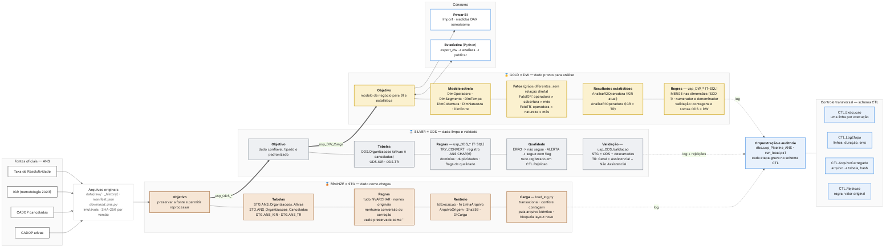

# NEXDOM · Desafio Técnico — Analista de BI Pleno
### Saúde suplementar: integração de operadoras, IGR e Taxa de Resolutividade (ANS)

Pipeline de dados completo, de **dados abertos da ANS** até um **modelo dimensional no SQL Server**, com **análises
estatísticas** e insumos para um **dashboard Power BI**. O projeto integra três bases públicas com granularidades
diferentes para responder: *quais operadoras têm mais reclamações proporcionalmente ao porte, quais combinam IGR alto e
baixa resolutividade, como porte, reclamações e resolução se relacionam, quem é outlier, como os indicadores evoluíram
e como os segmentos se comparam.*


<sub>🔍 **Versão vetorial com zoom:** [`docs/diagramas.md`](docs/diagramas.md) · entradas e saídas de cada etapa:
[`docs/diagrama_processo.md`](docs/diagrama_processo.md) · fonte [`.mmd`](docs/diagrama_processo.mmd) · [SVG](docs/img/diagrama_processo.svg)</sub>

---

## Status

| Etapa | Situação | Evidência |
|---|---|---|
| Coleta automatizada das bases oficiais | ✅ implementado e validado | `src/extraction/download_ans.py`, manifesto com SHA-256 |
| Exploração e profiling | ✅ implementado e validado | [`docs/achados_exploracao.md`](docs/achados_exploracao.md) |
| STG — carga fiel no SQL Server | ✅ implementado e validado | contagens STG = arquivos ([`docs/evidencias/stg_resumo.txt`](docs/evidencias/stg_resumo.txt)) |
| ODS — tratamento por stored procedures | ✅ implementado e validado | reconciliação STG = ODS + descartadas ([`pipeline_ods.txt`](docs/evidencias/pipeline_ods.txt)) |
| DW — modelo estrela + orquestração `usp_Pipeline_ANS` | ✅ implementado e validado | contagens e somas ODS = DW ([`pipeline_dw.txt`](docs/evidencias/pipeline_dw.txt)) |
| Análises estatísticas (5 obrigatórias + concentração) | ✅ implementado e validado | [`docs/resultados_analises.md`](docs/resultados_analises.md), `reports/figures/` |
| Publicação dos resultados estatísticos no DW | ✅ implementado e validado | `DW.AnaliseR2Operadora` (998) e `DW.AnaliseR1Operadora` (742) |
| Catálogo semântico: 49 medidas DAX + glossário | ✅ implementado e validado | fonte única → [`powerbi/medidas_uma_a_uma.md`](powerbi/medidas_uma_a_uma.md), [`medidas.dax`](powerbi/medidas.dax), `DW.Glossario` (61 termos), [`docs/glossario.md`](docs/glossario.md) |
| Dashboard Power BI | 🟧 parcial | modelo, DAX e layout prontos em [`powerbi/`](powerbi/); o `.pbix` está sendo montado manualmente |
| Relatório técnico (≤ 5 p.) e insights executivos (≤ 1 p.) | ⬜ planejado | — |
| Agendamento (SQL Server Agent) e testes de integração com o banco | ⬜ planejado | — |

---

## Fontes de dados (oficiais — ANS)

Todas baixadas de `https://dadosabertos.ans.gov.br/FTP/PDA/`. Os datasets do dados.gov.br indicados no desafio apontam
para estes mesmos arquivos. Detalhes, layouts e metodologias: [`docs/fontes_dados.md`](docs/fontes_dados.md).

| Base | Arquivo | Grão | Período |
|---|---|---|---|
| Operadoras ativas (CADOP) | `operadoras_de_plano_de_saude_ativas/Relatorio_cadop.csv` | registro ANS | retrato atual (1.101) |
| Operadoras canceladas | `operadoras_de_plano_de_saude_canceladas/Relatorio_cadop_canceladas.csv` | registro ANS | retrato atual (3.085) |
| IGR — metodologia 2023 | `IGR/IGR_versao_2023/pda-023-igr.csv` | operadora × cobertura × mês | 2015-01 → 2019-04 (congelada) e 2021-05 → 2026-10 |
| Taxa de Resolutividade | `taxa_de_resolutividade/pda-048-taxa_de_resolutividade.csv` | operadora × natureza × mês | 2015-01 → 2019-10 |

> **Achado que define o escopo:** a TR oficial termina em 2019-10 (a ANS adotou a TIR em 2025). IGR e TR só coexistem
> em **2015-01 → 2019-04**. O projeto trabalha com dois recortes: **IGR × TR** (mai/2018–abr/2019) e **IGR atual**
> (nov/2025–out/2026). Ver [`docs/limitacoes.md`](docs/limitacoes.md).

---

## Arquitetura

```
ANS (FTP PDA) ─► Python: coleta ─► SQL Server ANS_BI: STG ─► ODS ─► DW ─► Python: estatística ─► DW.Analise* ─► Power BI
                                      (carga fiel)   (stored procedures)    (sobre o DW exportado)
```

| Camada | Tecnologia | Responsabilidade | Paralelo Medallion* |
|---|---|---|---|
| Coleta | Python (`requests`) | download, hash, versões anteriores, manifesto | — |
| **STG** | Python (carga) + SQL | cópia fiel dos arquivos (`NVARCHAR`) com metadados de rastreio | Bronze |
| **ODS** | T-SQL (stored procedures) | tipagem, padronização, validação, rejeições com motivo, reconciliação | Silver |
| **DW** | T-SQL (stored procedures) | modelo estrela, chaves substitutas, validação ODS × DW | Gold |
| Controle | T-SQL (schema `CTL`) | log de execução e de etapas, arquivos carregados, rejeições | — |
| Estatística | Python (`scipy`) | ranking, índice combinado, outliers, correlações, séries | — |
| BI | Power BI | modelo semântico, medidas DAX, dashboard | — |

\*Paralelo conceitual: STG, ODS e DW são camadas arquiteturais; não são sinônimos estritos de Bronze, Silver e Gold.


<sub>Bronze ≈ STG, Silver ≈ ODS e Gold ≈ DW: objetivo, tabelas, regras e validação de cada camada, com controle
transversal no schema `CTL`. 🔍 Versão vetorial: [`docs/diagramas.md`](docs/diagramas.md) · explicação em
[`docs/arquitetura.md`](docs/arquitetura.md#visão-em-camadas-paralelo-com-a-arquitetura-medalhão).</sub>

**Modelo dimensional:** `DimOperadora`, `DimSegmento`, `DimTempo`, `DimCobertura`, `DimNatureza`, `DimPorte`,
**`FatoIGR`** (operadora × cobertura × mês) e **`FatoTR`** (operadora × natureza × mês). Os fatos são separados porque
as quebras diferem e se ligam apenas por dimensões compartilhadas. Guardam numerador e denominador, e as taxas são
sempre soma/soma. Detalhes em [`docs/arquitetura.md`](docs/arquitetura.md) e [`docs/dicionario_dados.md`](docs/dicionario_dados.md).

**Camada semântica:** um catálogo único (`src/semantic/`) define cada medida (DAX, formato, pasta, definição,
sentido de leitura). Dele saem o arquivo de medidas do Power BI, a tabela `DW.Glossario` e o glossário em Markdown.
Testes garantem que glossário e modelo nunca divergem.

**Tecnologias:** Python 3.11+ (pandas, SQLAlchemy, pyodbc, SciPy, Matplotlib, pytest) · SQL Server 2022 (T-SQL,
stored procedures, `MERGE`, Query Store) · Power BI · Git/GitHub · PowerShell.

---

## Estrutura do repositório

```
nexdom-bi-challenge/
├── run_local.ps1                 # ponto de entrada: executa as etapas na ordem e grava logs/
├── requirements.txt · .env.example · .gitignore
├── src/
│   ├── common/                   # db.py (conexão via .env) · ans_csv.py (leitura dos CSVs da ANS)
│   ├── extraction/download_ans.py      # 1  coleta das bases oficiais
│   ├── exploration/profile_raw.py      # 2  profiling (somente leitura)
│   ├── loading/load_stg.py             # 5  carga STG (+ --emit-ddl gera sql/02)
│   └── analysis/
│       ├── export_dw.py                # 8  DW → Parquet
│       ├── analises.py                 # 9  estatística e figuras
│   │   └── publicar_analises.py        # 10 resultados → DW.Analise*
│   └── semantic/                       # 12 catálogo único de medidas e conceitos
│       ├── catalogo.py · medidas_dax.json
│       └── gerar.py                    #    → powerbi/medidas*.{dax,md} · sql/09_glossario.sql · docs/glossario.md
├── sql/
│   ├── 01_create_schemas.sql … 09_glossario.sql   # estrutura, procedures, orquestração e glossário
│   ├── checks/                   # consultas de evidência e diagnóstico (não fazem parte do pipeline)
│   └── README.md
├── powerbi/                      # modelo, medidas DAX (medidas.dax), layout e tema do dashboard
├── docs/                         # arquitetura, regras, achados, resultados, desempenho, limitações, diagrama
│   ├── evidencias/               # saídas reais das execuções (STG, ODS, DW, desempenho)
│   └── img/                      # diagrama renderizado (PNG/SVG)
├── data/                         # raw/ e processed/ NÃO versionados (ver data/README.md)
│   └── processed/analises/       # exceção versionada: tabelas de resultados (agregadas)
├── reports/figures/              # 5 figuras das análises
└── tests/                        # testes de leitura, parsing, fórmulas e DDL (sem banco)
```

---

## Como executar

### Pré-requisitos
- Windows com PowerShell 5.1+ · Python 3.11+ · Git
- SQL Server 2017+ (desenvolvido e validado no **SQL Server 2022 Developer**, instância padrão), com `sqlcmd`
- ODBC Driver 18 (ou 17) for SQL Server
- Acesso à internet para `dadosabertos.ans.gov.br`

### 1. Configuração (uma vez)
```powershell
git clone https://github.com/Deogadox/nexdom-bi-challenge.git
cd nexdom-bi-challenge
python -m venv .venv; .\.venv\Scripts\Activate.ps1
pip install -r requirements.txt
Copy-Item .env.example .env      # ajuste SQL_SERVER / SQL_DATABASE / SQL_DRIVER se necessário
```
`.env` (não versionado): `SQL_SERVER=localhost`, `SQL_DATABASE=ANS_BI`, `SQL_DRIVER=ODBC Driver 18 for SQL Server`,
`SQL_TRUSTED_CONNECTION=yes` (autenticação Windows). Com login SQL, preencha `SQL_USER`/`SQL_PASSWORD`.

> **Atenção à instância:** o `.env`, o SSMS e o Power BI precisam apontar para a **mesma** instância
> (ex.: `localhost` ≠ `localhost\SQLEXPRESS`). Confira com `SELECT @@SERVERNAME`.

**Memória da instância (recomendado):** em máquinas com pouca RAM livre, o SQL Server pode ficar com poucos MB para
consultas e travar na fila de memória (diagnóstico em [`docs/desempenho.md`](docs/desempenho.md)):
```sql
EXEC sp_configure 'show advanced options', 1; RECONFIGURE;
EXEC sp_configure 'min server memory (MB)', 1024; EXEC sp_configure 'max server memory (MB)', 3072; RECONFIGURE;
```

### 2. Execução completa (atalho)
```powershell
powershell -ExecutionPolicy Bypass -File .\run_local.ps1 -Etapas todas
```
Executa, na ordem: `setup → download → profile → db → check → stg → ods → dw → analises → glossario`. Cada etapa para no primeiro
erro e grava a transcrição em `logs\run_local_<data>.log`. Também é possível rodar etapas isoladas
(ex.: `-Etapas stg,ods`).

### 3. Execução manual, passo a passo
Sempre a partir da raiz do projeto, com o `.venv` ativo. No SSMS, os `.sql` podem ser abertos e executados (F5) na mesma
ordem; no `sqlcmd`, use `-I` (QUOTED_IDENTIFIER) e `-f 65001` (UTF-8).

| # | Comando | O que faz | Produz |
|---|---|---|---|
| 1 | `python -m src.extraction.download_ans` | baixa as 4 bases, os dicionários e as notas técnicas | `data/raw/`, `manifest.json`, `_history/` |
| 2 | `python -m src.exploration.profile_raw` | profiling (somente leitura) | `docs/profiling_raw.md`, `data/processed/profiling/` |
| 3 | `sqlcmd -S localhost -E -b -I -f 65001 -i sql\01_create_schemas.sql` | banco `ANS_BI`, schemas, controle | `STG`, `ODS`, `DW`, `CTL` |
| 4 | `sqlcmd … -i sql\02_create_stg_tables.sql` | tabelas STG | `STG.*` |
| 5 | `python -m src.loading.load_stg` | carga fiel e transacional (`--force` recarrega arquivo idêntico) | `STG.*`, `CTL.ArquivoCarregado` |
| 6 | `sqlcmd … -i sql\03_…` → `04_…` → `05_…` → `06_…` → `07_…` | tabelas ODS/DW, procedures e orquestração | objetos `ODS`, `DW`, procedures |
| 7 | `sqlcmd -S localhost -E -b -I -d ANS_BI -Q "EXEC dbo.usp_Pipeline_ANS"` | STG → ODS → validação → DW → validação | `ODS.*`, `DW.*`, `CTL.LogEtapa`, `CTL.Rejeicao` |
| 8 | `python -m src.analysis.export_dw` | DW → Parquet com somas de controle | `data/processed/dw/` |
| 9 | `python -m src.analysis.analises` | estatística e figuras | `data/processed/analises/`, `reports/figures/` |
| 10 | `sqlcmd … -i sql\08_create_analise_tables.sql` + `python -m src.analysis.publicar_analises` | publica os resultados no DW | `DW.AnaliseR2Operadora`, `DW.AnaliseR1Operadora` |
| 11 | Power BI Desktop → SQL Server `localhost` / `ANS_BI` (Importar) | dashboard | ver [`powerbi/README.md`](powerbi/README.md) |
| 12 | `python -m src.semantic.gerar` + `sqlcmd … -i sql\09_glossario.sql` | gera medidas e glossário do catálogo; carrega o glossário | `powerbi/medidas.dax`, `docs/glossario.md`, `DW.Glossario` |

Os scripts Python também rodam pelo botão *Run* do VS Code. Todos os `.sql` são idempotentes: criam apenas o que não
existe, e as procedures reconstroem seus alvos.

### 4. Atualização mensal (estrutura já criada)
```powershell
powershell -ExecutionPolicy Bypass -File .\run_local.ps1 -Etapas download,stg,dw,analises
```
Arquivos sem mudança (mesmo SHA-256) não são recarregados. O pipeline reconstrói ODS e DW a partir da STG.

### 5. Testes e evidências
```powershell
python -m pytest -q          # 17 testes: leitura, parsing, fórmulas do IGR/TR, DDL, catálogo de medidas e glossário
```
As consultas em `sql/checks/` geram as evidências (`logs/*.txt`). As das execuções validadas estão em `docs/evidencias/`.

---

## Resultados de validação (execução 7 do pipeline)

| Checagem | Resultado |
|---|---|
| STG = linhas dos arquivos | 1.101 · 3.085 · 130.155 · 63.366 ✔ |
| ODS: STG = ODS + descartadas | IGR 130.155 = 130.136 + 19 duplicidades (alerta) ✔ · TR e cadastro sem perdas ✔ |
| TR: Geral = Assistencial + Não Assistencial | 0 divergências ✔ |
| Registros de IGR/TR encontrados no cadastro | 100% (1.417 e 1.210) ✔ |
| DW: contagens e somas = ODS | reclamações 2.035.422 · beneficiários 9.126.310.967 · numerador 814.662 · denominador 947.360 ✔ |
| Tempo do pipeline completo (STG → DW) | 30 s |

## Principais resultados
Detalhes, testes estatísticos e ressalvas em [`docs/resultados_analises.md`](docs/resultados_analises.md).
- IGR médico em alta na série vigente: de 31 para 60 reclamações por 100 mil beneficiários (Spearman ρ = 0,63); a
  **Autogestão triplicou** (16,6 → 51,7, jan–out de 2022 a 2026).
- **Seguradoras** têm o maior IGR agregado (74,2); a mediana por operadora mostra outra leitura (Medicina de Grupo, 38,2).
- **20 outliers críticos** no IGR atual (funil de Poisson com ajuste de sobredispersão + discrepância no próprio segmento).
- **49 operadoras médico-hospitalares críticas** em IGR × TR (2018–19). Índice combinado estável a mudanças de peso (ρ ≥ 0,92).
- IGR × TR: associação monotônica não significativa (ρ = −0,12; p = 0,07). Os indicadores medem dimensões diferentes.
- As 10 operadoras com mais reclamações concentram 52% das reclamações (40,5% dos beneficiários).

## Documentação
| Documento | Conteúdo |
|---|---|
| [`docs/diagrama_processo.md`](docs/diagrama_processo.md) | fluxo de execução, entradas e saídas de cada etapa |
| [`docs/diagramas.md`](docs/diagramas.md) | os dois diagramas em versão vetorial (zoom) — camadas Medalhão e processo |
| [`docs/arquitetura.md`](docs/arquitetura.md) | camadas, responsabilidades, modelo dimensional, controle |
| [`docs/fontes_dados.md`](docs/fontes_dados.md) | fontes, layouts e metodologias oficiais do IGR e da TR |
| [`docs/achados_exploracao.md`](docs/achados_exploracao.md) | achados do profiling (períodos, duplicidades, chaves) |
| [`docs/regras_de_negocio.md`](docs/regras_de_negocio.md) | regras de tratamento STG → ODS (ERRO/ALERTA) |
| [`docs/dicionario_dados.md`](docs/dicionario_dados.md) | tabelas e colunas do ODS, DW e controle |
| [`docs/glossario.md`](docs/glossario.md) | definição de todas as medidas e conceitos do dashboard (gerado do catálogo) |
| [`docs/resultados_analises.md`](docs/resultados_analises.md) | resultados estatísticos (evidência × hipótese) |
| [`docs/desempenho.md`](docs/desempenho.md) | diagnóstico de lentidão por memória (Query Store, esperas) |
| [`docs/limitacoes.md`](docs/limitacoes.md) | limitações das bases e do projeto |
| [`sql/README.md`](sql/README.md) · [`data/README.md`](data/README.md) | scripts SQL e organização dos dados |
| [`powerbi/`](powerbi/) | conexão, modelo, medidas DAX, layout e tema |

## Próximos passos (planejados, não implementados)
Concluir o `.pbix` · relatório técnico (≤ 5 p.) e insights executivos (≤ 1 p.) · agendamento via SQL Server Agent ·
testes automatizados de integração com o banco · preparação para a entrevista técnica.

---
**Autor:** Felipe Rios Miranda · [github.com/Deogadox](https://github.com/Deogadox) · Dados públicos da ANS.
