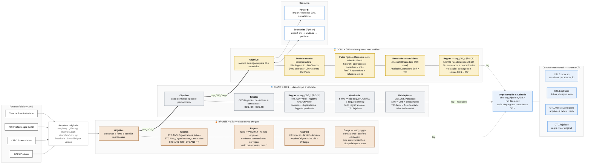

# Arquitetura técnica

`Python (coleta) → SQL Server: STG → ODS → DW → Python (estatística) → DW.Analise* → Power BI`

O **SQL Server é o motor de tratamento e integração**. O Python coleta, carrega a STG sem aplicar regra de negócio,
e calcula a estatística sobre o DW pronto. Fluxo completo: [`diagrama_processo.md`](diagrama_processo.md).

## Visão em camadas (paralelo com a arquitetura Medalhão)


<sub>Fonte: [`diagrama_medalhao.mmd`](diagrama_medalhao.mmd) · [SVG](img/diagrama_medalhao.svg)</sub>

| | 🥉 Bronze ≈ **STG** | 🥈 Silver ≈ **ODS** | 🥇 Gold ≈ **DW** |
|---|---|---|---|
| Pergunta que responde | "O que a ANS publicou?" | "O dado é confiável?" | "O que o negócio precisa ver?" |
| Estado do dado | como chegou, tudo texto | tipado, padronizado, validado | modelado (estrela) e agregável |
| Quem escreve | `load_stg.py` (Python) | `usp_ODS_*` (T-SQL) | `usp_DW_*` (T-SQL) + `publicar_analises.py` |
| Regra principal | nenhuma transformação | ERRO não segue; ALERTA segue com flag | grão explícito; taxas como soma/soma |
| Garantia | contagem STG = arquivo | STG = ODS + descartadas | contagens e somas ODS = DW |
| Reprocessamento | TRUNCATE + carga do arquivo vigente | reconstrução a partir da STG | dimensões por MERGE, fatos reconstruídos |

**Por que "paralelo" e não "sinônimo":**
- A arquitetura Medalhão nasceu em *lakehouses*: arquivos em formatos como Delta e Parquet, processamento distribuído, e
  em geral várias versões do dado acumuladas na Bronze.
- Aqui as três camadas são **schemas de um banco relacional** (SQL Server), e o tratamento é feito por stored procedures.
- O ODS é uma camada operacional tipada, que não guarda histórico.
- A intenção é a mesma: **preservar → tratar → modelar**, com rastreabilidade entre camadas.
- O histórico das versões da fonte fica nos arquivos (`data/raw/_history/`, `manifest.json`) e em `CTL.ArquivoCarregado`,
  não em várias cargas acumuladas na STG. A ANS republica a série completa todo mês, com revisões, então acumular
  cargas duplicaria as competências.

## Responsabilidades por camada

| Camada | Tecnologia | Faz | Não faz |
|---|---|---|---|
| Coleta | Python `src/extraction/download_ans.py` | download, SHA-256, `_history/`, `manifest.json`, log | altera arquivos |
| Exploração | Python `src/exploration/profile_raw.py` | profiling somente leitura | grava no banco |
| **STG** (≈ Bronze) | Python `src/loading/load_stg.py` + `sql/02` | cópia fiel em `NVARCHAR`, nomes originais, `IdExecucao`/`NrLinhaArquivo`/`ArquivoOrigem`/`Sha256`/`DtCarga` | converte tipos ou corrige valores |
| **ODS** (≈ Silver) | T-SQL `sql/05` (`dbo.usp_ODS_*`) | `TRY_CONVERT`, registro ANS `CHAR(6)`, domínios, duplicidades, flags, rejeições com motivo, reconciliação | apaga linha sem registro em `CTL.Rejeicao` |
| **DW** (≈ Gold) | T-SQL `sql/06` (`dbo.usp_DW_*`) | dimensões por `MERGE` (chaves estáveis, SCD tipo 1), fatos por TRUNCATE + INSERT, validação ODS × DW | mistura grãos |
| Orquestração | T-SQL `sql/07` (`dbo.usp_Pipeline_ANS`) + `run_local.ps1` | ordem das etapas, interrupção em falha, `CTL.Execucao` | — |
| Estatística | Python `src/analysis/*` | lê o DW exportado (Parquet), calcula e publica `DW.Analise*` | refaz regras do ODS |
| BI | Power BI (`powerbi/`) | modelo semântico, DAX, dashboard | lê STG ou ODS |

O paralelo Medallion é conceitual. STG, ODS e DW são camadas arquiteturais de um banco relacional e não equivalem
estritamente a Bronze, Silver e Gold de um lakehouse.

**Sem duplicação de regras:** o tratamento existe só em T-SQL. A estatística (percentis, funil de Poisson,
z robusto) existe só em Python e é publicada no DW. O DAX apenas agrega (soma/soma) e aplica os pesos escolhidos pelo usuário.

## Controle e auditoria (schema `CTL`)
| Objeto | Conteúdo |
|---|---|
| `CTL.Execucao` | uma linha por execução: origem, início, fim, status (`EM_ANDAMENTO`/`SUCESSO`/`FALHA`), mensagem |
| `CTL.LogEtapa` | etapa, objeto, linhas lidas/inseridas/atualizadas/rejeitadas, duração, erro (número e linha) |
| `CTL.ArquivoCarregado` | arquivo, URL, SHA-256, encoding, `Last-Modified`, tabela de destino, linhas |
| `CTL.Rejeicao` | linha do arquivo, chave, regra, coluna, valor original, severidade (`ERRO`/`ALERTA`) |
| `CTL.usp_IniciarExecucao`, `usp_RegistrarEtapa`, `usp_FinalizarExecucao` | API de log usada pelas procedures e pelo Python |

Toda procedure usa `TRY/CATCH` + transação (`XACT_ABORT ON`), registra a etapa e relança o erro para a orquestração.

## Modelo dimensional (implementado — `sql/04`)

```
                 DimSegmento
                      │ 1:*
DimTempo ──1:*── FatoIGR ──*:1── DimOperadora ──1:*── FatoTR ──*:1── DimTempo
                  │    │                │                  │
           DimCobertura DimPorte        │             DimNatureza
                                        └──1:*── AnaliseR2Operadora / AnaliseR1Operadora (sql/08)
```

| Tabela | Grão | Observação |
|---|---|---|
| `DW.DimOperadora` | registro ANS | ativas ∪ canceladas; membro −1 "Não informada" |
| `DW.DimSegmento` | modalidade CADOP | `Segmento` (legadas "Seguradora" e "Administradora" mapeadas) e `GrupoAssistencial` |
| `DW.DimTempo` | mês (`SkTempo` AAAAMM) | flags `FlIGRDisponivel`, `FlTRDisponivel`, `FlJanelaComumIGRTR`, `SerieIGR` |
| `DW.DimCobertura` / `DimNatureza` / `DimPorte` | domínio | `DimNatureza.FlTotal` marca "Geral" (= A + N) |
| `DW.FatoIGR` | operadora × cobertura × mês | reclamações, beneficiários, porte do mês, `IGRCalculado` (persistida) |
| `DW.FatoTR` | operadora × natureza × mês | numerador e denominador |
| `DW.AnaliseR2Operadora` | operadora × cobertura | IGR 12 meses atuais, elegibilidade, funil, IQR/z, outlier consistente |
| `DW.AnaliseR1Operadora` | operadora | IGR × TR 2018–19, scores por percentil, índice combinado, quadrante |

- **Fatos separados:** IGR quebra por cobertura e TR por natureza. Não há relação linha a linha, então uma tabela única
  ou um relacionamento direto multiplicaria registros. A comparação passa por `DimOperadora` e `DimTempo`.
- **Numerador e denominador** guardados: o IGR e a TR são recompostos em qualquer nível como soma/soma.
- **Porte no fato:** muda ao longo do tempo e entre coberturas da mesma operadora (184 casos na série vigente).

## Ambiente de execução
- **Validado em:** Windows 10, SQL Server 2022 Developer (instância padrão `localhost`), ODBC Driver 18 e Python com `.venv`.
- **Requisitos de T-SQL:** SQL Server 2017+ (`STRING_AGG`, `TRIM`, `CREATE OR ALTER`, `DROP … IF EXISTS`).
- **Opções de sessão:** os scripts declaram `ANSI_NULLS` e `QUOTED_IDENTIFIER ON`, exigidos pela coluna computada
  persistida. No `sqlcmd`, use `-I` e `-f 65001` (UTF-8).
- **Memória:** as instruções pesadas usam `OPTION (MAX_GRANT_PERCENT = 10)`. A configuração de memória mínima e
  máxima da instância está em [`desempenho.md`](desempenho.md).
- **Agendamento:** não configurado. A execução é manual (`run_local.ps1`); o SQL Server Agent está planejado.
