# Diagramas (versão vetorial, renderizada pelo GitHub)

<!-- GERADO a partir de docs/diagrama_medalhao.mmd e docs/diagrama_processo.mmd — edite os .mmd e regenere este arquivo -->

Os blocos abaixo são renderizados nativamente pelo GitHub (vetor, nitidez em qualquer zoom). Também há versões em
imagem de alta resolução: [medalhão PNG](img/diagrama_medalhao.png) · [SVG](img/diagrama_medalhao.svg) ·
[processo PNG](img/diagrama_processo.png) · [SVG](img/diagrama_processo.svg).

## 1. Arquitetura em camadas — paralelo Medalhão (Bronze ≈ STG · Silver ≈ ODS · Gold ≈ DW)
Explicação: [`arquitetura.md`](arquitetura.md#visão-em-camadas-paralelo-com-a-arquitetura-medalhão).

```mermaid
flowchart LR
    classDef fonte fill:#ffffff,stroke:#191919,stroke-width:1px,color:#191919
    classDef bronze fill:#f6e6d6,stroke:#a0622d,stroke-width:1.5px,color:#191919
    classDef silver fill:#eef0f3,stroke:#7d8691,stroke-width:1.5px,color:#191919
    classDef gold fill:#fbf1cf,stroke:#c79a00,stroke-width:1.5px,color:#191919
    classDef ctl fill:#e8f1fc,stroke:#257de0,stroke-width:1.2px,color:#191919
    classDef consumo fill:#ffffff,stroke:#257de0,stroke-width:1.2px,color:#191919
    classDef nota fill:#ffffff,stroke:#cfcfcf,stroke-width:1px,color:#666666

    subgraph SRC["Fontes oficiais — ANS"]
        direction TB
        A1["CADOP ativas"]:::fonte
        A2["CADOP canceladas"]:::fonte
        A3["IGR (metodologia 2023)"]:::fonte
        A4["Taxa de Resolutividade"]:::fonte
    end

    RAW["<b>Arquivos originais</b><br/>data/raw/ · _history/ · manifest.json<br/><i>download_ans.py</i><br/>imutáveis · SHA-256 por versão"]:::nota

    subgraph BRONZE["🥉 BRONZE ≈ STG — dado como chegou"]
        direction TB
        B0["<b>Objetivo</b><br/>preservar a fonte e permitir reprocessar"]:::bronze
        B1["<b>Tabelas</b><br/>STG.ANS_Organizacoes_Ativas<br/>STG.ANS_Organizacoes_Canceladas<br/>STG.ANS_IGR · STG.ANS_TR"]:::bronze
        B2["<b>Regras</b><br/>tudo NVARCHAR · nomes originais<br/>nenhuma conversão ou correção<br/>vazio preservado como ''"]:::bronze
        B3["<b>Rastreio</b><br/>IdExecucao · NrLinhaArquivo<br/>ArquivoOrigem · Sha256 · DtCarga"]:::bronze
        B4["<b>Carga</b> — load_stg.py<br/>transacional · confere contagem<br/>pula arquivo idêntico · bloqueia layout novo"]:::bronze
        B0 --- B1 --- B2 --- B3 --- B4
    end

    subgraph SILVER["🥈 SILVER ≈ ODS — dado limpo e validado"]
        direction TB
        S0["<b>Objetivo</b><br/>dado confiável, tipado e padronizado"]:::silver
        S1["<b>Tabelas</b><br/>ODS.Organizacoes (ativas ∪ canceladas)<br/>ODS.IGR · ODS.TR"]:::silver
        S2["<b>Regras</b> — usp_ODS_* (T-SQL)<br/>TRY_CONVERT · registro ANS CHAR(6)<br/>domínios · duplicidades · flags de qualidade"]:::silver
        S3["<b>Qualidade</b><br/>ERRO → não segue · ALERTA → segue com flag<br/>tudo registrado em CTL.Rejeicao"]:::silver
        S4["<b>Validação</b> — usp_ODS_Validacao<br/>STG = ODS + descartadas<br/>TR: Geral = Assistencial + Não Assistencial"]:::silver
        S0 --- S1 --- S2 --- S3 --- S4
    end

    subgraph GOLD["🥇 GOLD ≈ DW — dado pronto para análise"]
        direction TB
        G0["<b>Objetivo</b><br/>modelo de negócio para BI e estatística"]:::gold
        G1["<b>Modelo estrela</b><br/>DimOperadora · DimSegmento · DimTempo<br/>DimCobertura · DimNatureza · DimPorte"]:::gold
        G2["<b>Fatos</b> (grãos diferentes, sem relação direta)<br/>FatoIGR: operadora × cobertura × mês<br/>FatoTR: operadora × natureza × mês"]:::gold
        G3["<b>Resultados estatísticos</b><br/>AnaliseR2Operadora (IGR atual)<br/>AnaliseR1Operadora (IGR × TR)"]:::gold
        G4["<b>Regras</b> — usp_DW_* (T-SQL)<br/>MERGE nas dimensões (SCD 1) · numerador e denominador<br/>validação: contagens e somas ODS = DW"]:::gold
        G0 --- G1 --- G2 --- G3 --- G4
    end

    subgraph USO["Consumo"]
        direction TB
        U1["<b>Power BI</b><br/>Import · medidas DAX soma/soma"]:::consumo
        U2["<b>Estatística</b> (Python)<br/>export_dw → analises → publicar"]:::consumo
    end

    subgraph CTL["Controle transversal — schema CTL"]
        direction LR
        C1["CTL.Execucao<br/>uma linha por execução"]:::ctl
        C2["CTL.LogEtapa<br/>linhas, duração, erro"]:::ctl
        C3["CTL.ArquivoCarregado<br/>arquivo → tabela, hash"]:::ctl
        C4["CTL.Rejeicao<br/>regra, valor original"]:::ctl
    end

    ORQ["<b>Orquestração e auditoria</b><br/>dbo.usp_Pipeline_ANS · run_local.ps1<br/>cada etapa grava no schema CTL"]:::ctl

    A1 & A2 & A3 & A4 --> RAW
    RAW --> B0
    B0 == "usp_ODS_*" ==> S0
    S0 == "usp_DW_Carga" ==> G0
    G0 --> U1
    G0 <--> U2
    B4 -. log .-> ORQ
    S4 -. log + rejeições .-> ORQ
    G4 -. log .-> ORQ
    ORQ --- CTL
```

## 2. Processo e ordem de execução (passos 1 → 12)
Tabela de entradas, saídas e próxima etapa: [`diagrama_processo.md`](diagrama_processo.md).

```mermaid
flowchart TD
    classDef ok fill:#e8f1fc,stroke:#257de0,stroke-width:1.5px,color:#191919
    classDef parcial fill:#fff1e8,stroke:#f47230,stroke-width:1.5px,color:#191919
    classDef plan fill:#f5f5f5,stroke:#9c9c9c,stroke-width:1.2px,stroke-dasharray:5 4,color:#666666
    classDef fonte fill:#ffffff,stroke:#191919,stroke-width:1px,color:#191919
    classDef dado fill:#ffffff,stroke:#9c9c9c,stroke-width:1px,color:#191919

    subgraph LEG["Legenda"]
        direction LR
        L1["Implementado e validado<br/>com execução real"]:::ok
        L2["Parcialmente<br/>implementado"]:::parcial
        L3["Planejado —<br/>não desenvolvido"]:::plan
    end

    START(["▶ Ponto de entrada<br/><b>run_local.ps1 -Etapas todas</b><br/>ou cada comando manualmente, na ordem 1→12"]):::ok

    subgraph ANS["Fontes oficiais — ANS · dadosabertos.ans.gov.br/FTP/PDA"]
        direction LR
        F1["CADOP ativas<br/>Relatorio_cadop.csv"]:::fonte
        F2["CADOP canceladas<br/>Relatorio_cadop_canceladas.csv"]:::fonte
        F3["IGR metodologia 2023<br/>pda-023-igr.csv"]:::fonte
        F4["Taxa de Resolutividade<br/>pda-048-taxa_de_resolutividade.csv"]:::fonte
    end

    subgraph PY1["Python — coleta e inspeção"]
        S1["<b>1 · python -m src.extraction.download_ans</b><br/>baixa dados, dicionários .ods e notas técnicas<br/>calcula SHA-256; versão anterior → _history/"]:::ok
        S2["<b>2 · python -m src.exploration.profile_raw</b><br/>granularidade, períodos, nulos, duplicidades,<br/>fórmulas oficiais e cobertura de chaves"]:::ok
    end

    R1[("data/raw/&lt;fonte&gt;/*<br/>data/raw/&lt;fonte&gt;/_history/<br/>data/raw/manifest.json<br/>logs/extraction.log")]:::dado
    R2[("docs/profiling_raw.md<br/>data/processed/profiling/profile.json")]:::dado

    subgraph SQLDDL["SQL Server · ANS_BI — estrutura"]
        S3["<b>3 · sql/01_create_schemas.sql</b><br/>banco, schemas STG · ODS · DW · CTL<br/>CTL.Execucao · LogEtapa · ArquivoCarregado · Rejeicao"]:::ok
        S4["<b>4 · sql/02_create_stg_tables.sql</b><br/>4 tabelas STG em NVARCHAR<br/>gerado por load_stg --emit-ddl a partir dos cabeçalhos reais"]:::ok
    end

    S5["<b>5 · python -m src.loading.load_stg</b><br/>carga fiel e transacional · confere contagem<br/>ignora arquivo idêntico (sha256) · bloqueia mudança de layout"]:::ok
    T1[("STG.ANS_Organizacoes_Ativas · _Canceladas<br/>STG.ANS_IGR · STG.ANS_TR<br/>CTL.ArquivoCarregado · logs/loading.log")]:::dado

    S6["<b>6 · sql/03 → 07</b><br/>03 tabelas ODS · 04 modelo estrela DW<br/>05 procedures ODS · 06 procedures DW · 07 orquestração"]:::ok

    subgraph PIPE["7 · EXEC dbo.usp_Pipeline_ANS — tratamento e integração 100% em T-SQL"]
        direction TB
        P0["verificação da STG"]:::ok
        P1["usp_ODS_Organizacoes → usp_ODS_IGR → usp_ODS_TR<br/>tipagem · registro ANS CHAR(6) · domínios · duplicidades<br/>ERRO / ALERTA em CTL.Rejeicao"]:::ok
        P2["usp_ODS_Validacao<br/>reconciliação STG = ODS + descartadas · Geral = A + N"]:::ok
        P3["usp_DW_Carga<br/>Dimensoes (MERGE) → Fatos → Validacao (contagens e somas)"]:::ok
        P0 --> P1 --> P2 --> P3
    end
    T2[("ODS.Organizacoes · ODS.IGR · ODS.TR<br/>DW.Dim* (6) · DW.FatoIGR · DW.FatoTR<br/>CTL.LogEtapa · CTL.Rejeicao")]:::dado

    subgraph PY2["Python — estatística sobre o DW"]
        S8["<b>8 · python -m src.analysis.export_dw</b><br/>DW → Parquet com somas de controle"]:::ok
        S9["<b>9 · python -m src.analysis.analises</b><br/>ranking · índice combinado · funil de Poisson<br/>IQR e z robusto · Spearman/Pearson · séries · segmentos"]:::ok
        S10["<b>10 · sql/08_create_analise_tables.sql</b><br/><b>+ python -m src.analysis.publicar_analises</b><br/>grava os resultados estatísticos no DW"]:::ok
    end
    T3[("data/processed/dw/*.parquet")]:::dado
    T4[("data/processed/analises/*.csv · resultados.json<br/>reports/figures/*.png · docs/resultados_analises.md")]:::dado
    T5[("DW.AnaliseR2Operadora (IGR atual)<br/>DW.AnaliseR1Operadora (IGR × TR)")]:::dado

    S12["<b>12 · python -m src.semantic.gerar</b><br/><b>+ sql/09_glossario.sql</b><br/>catálogo único → 42 medidas DAX + glossário<br/>testes garantem que não divergem"]:::ok
    T6[("powerbi/medidas.dax · docs/glossario.md<br/>DW.Glossario (42 medidas + 12 conceitos)")]:::dado

    S11["<b>11 · Power BI Desktop</b> (montagem manual)<br/>conexão Import em localhost/ANS_BI · schema DW<br/>pronto: modelo, DAX e layout em powerbi/<br/>pendente: arquivo .pbix em construção"]:::parcial

    subgraph PLAN["Planejado — ainda não desenvolvido"]
        direction LR
        X1["Relatório técnico<br/>(máx. 5 páginas)"]:::plan
        X2["Insights executivos<br/>(máx. 1 página)"]:::plan
        X3["Agendamento<br/>(SQL Server Agent)"]:::plan
        X4["Testes automatizados<br/>de integração com o banco"]:::plan
        X5["Preparação para<br/>a entrevista"]:::plan
    end

    CHK["sql/checks/*.sql — evidências e diagnóstico<br/>stg/ods/dw_resumo · perf_* · em_execucao<br/>→ logs/*.txt · docs/evidencias/"]:::ok

    START --> S1
    F1 & F2 & F3 & F4 --> S1
    S1 --> R1 --> S2 --> R2
    R2 -. define layout .-> S4
    S2 --> S3 --> S4 --> S5
    R1 --> S5
    S5 --> T1 --> S6 --> PIPE
    PIPE --> T2 --> S8 --> T3 --> S9 --> T4
    S9 --> S10 --> T5
    T2 --> S11
    T5 --> S11
    S12 --> T6 --> S11
    S11 --> PLAN
    T4 -.-> X1
    T2 -. auditoria .-> CHK
```

